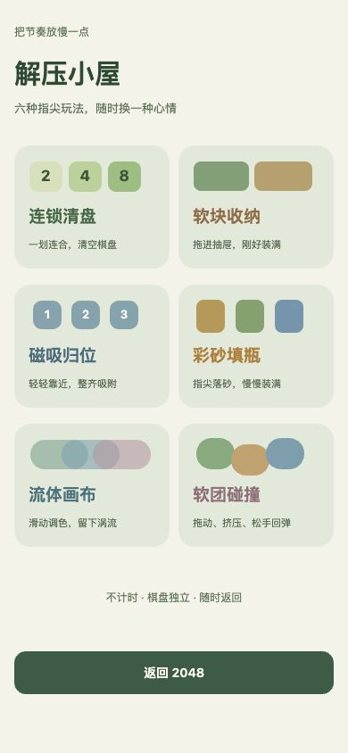
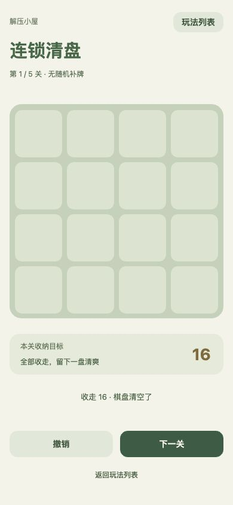
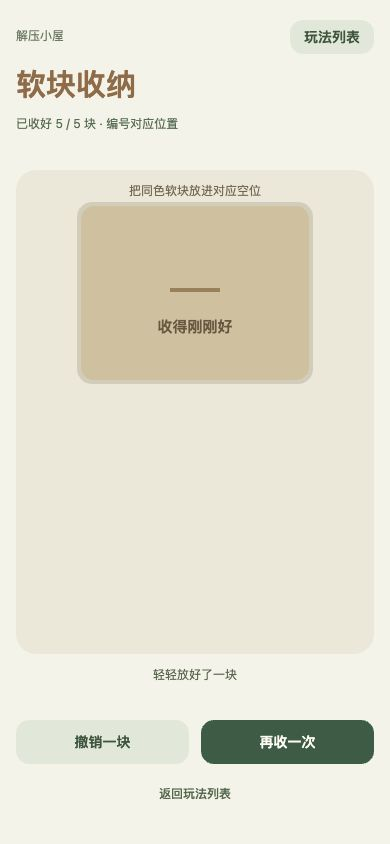
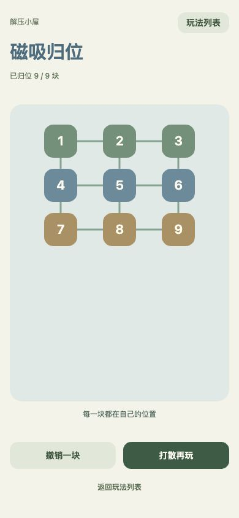
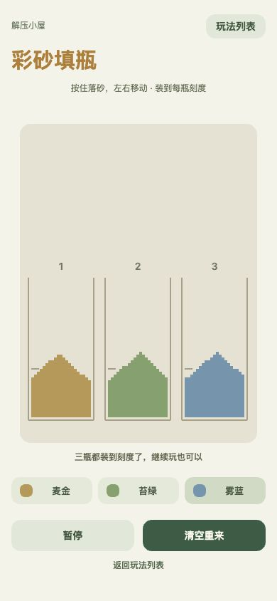
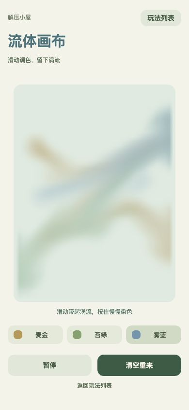
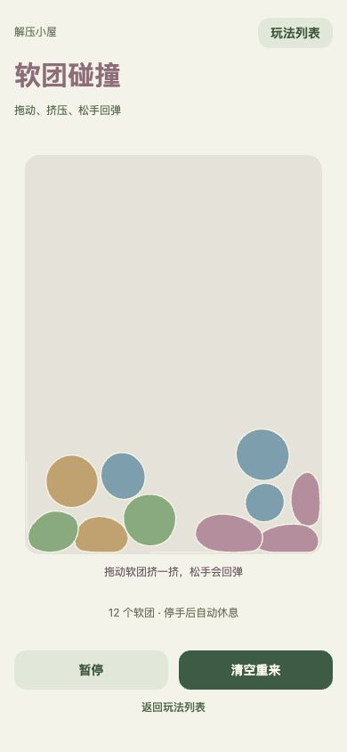

# 解压小屋：浏览器体验记录

2026-10-17，390×844 浏览器视口。六种玩法均在同一上屏 Canvas 内切换。规则、数值模型、独立存档和性能限制详见项目 README 的「解压小屋」章节。

## 1. 玩法列表

从 2048 标题旁的「解压小屋」进入，六张卡片可选择，返回按钮回到原有棋盘。列表静止时没有循环动画。

## 2. 连锁清盘

实际向左滑动首关，2、2、4、8 依次合成并收走 16，显示清空结果和下一关入口；其余四关已用规则搜索验证可解。

## 3. 软块收纳

实际拖动五个编号形状到同号空位，吸附落位并显示 5/5，抽屉合上。修复了连续拖放时上一块的动画阻塞下一块操作的问题，增加对应回归测试。

## 4. 磁吸归位

实际逐一拖动九块磁片，进入目标吸附半径后松手，完成 9/9；相邻已归位位置之间的连接线显示。

## 5. 彩砂填瓶

分别选择三种颜色并长按对应容器上方，验证持续落砂、落地堆积与三瓶目标完成。到达目标后仍允许自由玩；容量受限，可暂停或清空。

## 6. 流体画布

实际滑动注入染色和速度，切换三色并交叉搅动，染色随流场搬运；检查暂停按钮显示「已暂停，慢慢来」。这是轻量二维染色流场，不是三维自由表面液体。

## 7. 软团碰撞

实际观察 12 个软团落地、堆叠、挤压形变，并拖动后松手；检查暂停。固定 120 个节点，停手后最多 600 个积分步即休眠，不持续计算接触抖动。

## 验证与限制

99 项自动化测试通过。包含五关可解、守恒和边界、吸附与撤销、快速连续拖放、模拟数量限制、速度衰减、节点形变与休眠、独立进度恢复、后台停帧、高频触摸合帧和离屏上下文不可用时回退。双平台构建的全部 src 文件已与工作区源码逐一核对。

浏览器检查使用独立 localhost 存储进行实际操作，避免消耗 127.0.0.1 上的原有 2048 棋盘。最终交付预览打开原有地址的玩法列表，可返回继续 2048。截图反映浏览器状态，不代表微信 / 抖音宿主、所有手机帧率或长时间温升已验收；本轮未上传、提审或推送远程仓库。
