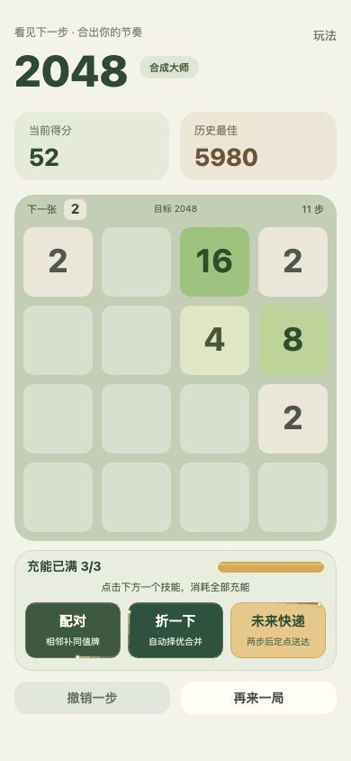
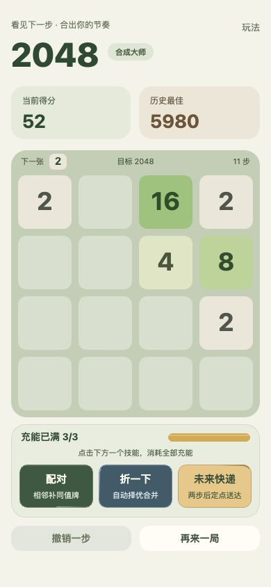

# 技能颜色与柔和绕边检查

检查日期：2026-10-17。范围为当前单页游戏，浏览器 390×844 视口、三个技能均可用的同一棋盘；使用 Product Design audit 流程。只刷新和调整预览视口，没有执行技能或移动棋盘。以下两张截图为本轮实际捕获、保存并检查的页面。

## 1. 调整前页面：主要层次清楚，技能区有两处视觉干扰

- 分数、棋盘、技能的顺序清楚，分数区到棋盘间距紧凑，按钮位置稳定。
- 配对和折一下都是深绿，扫视时不易区分；流星的白色头部与光晕形成过亮的点状装饰。小字号规则说明还可加强。
- 顶部和棋盘结构没有发现需要重新分区的问题。

## 2. 调整后页面：配色区分、动效克制，辅助文字更清楚

- 配对为苔绿、折一下为灰蓝、未来快递为暖沙，标题保留以避免只靠颜色区分技能。绕边对应使用灰绿、灰蓝、铜色。
- 移除独立头部、光晕和白色亮点。固定 1.7 像素线宽，12 段沿圆角路径形成透明度渐变，末端也不超过 0.66 透明度；每圈 3.2 秒，三个按钮错位。前后截图中的流星位置不同是循环动画所致。
- 技能说明从 10 提升为 11 设计像素；得分标签、目标文字和辅助说明加深。保留棋盘为视觉主体，按钮和触摸区域不位移。
- 沿用 30fps 局部重绘、初始化缓存边缘轨迹、后台停帧及减少动态效果设置。每按钮每帧最多 12 次短路径描边，无渐变对象、模糊、阴影、粒子或新增画布。

## 验证与限制

82 项测试通过，包括透明度单向变化、无光点填充、固定线宽、跨圈路径连续、局部帧率预算，以及自动择优折叠与撤销等已有行为。双平台重新构建并核对 src 内容一致，浏览器未出现警告或错误。

截图与规则测试不能证明完整无障碍支持；Canvas 缺少逐控件语义，屏幕阅读器和键盘按钮操作仍需单独评估。本轮视觉检查为 390×844，辅助字随整体画布缩放，小屏真机的可读性和点击尺寸仍值得重点检查。宿主胶囊 / 系统安全区与长时间温升需要微信、抖音真机验证。

建议下一步在小屏真机确认说明文字与操作区域，再决定是否采用紧凑布局；当前不需要继续增加分区、阴影或持续装饰。
