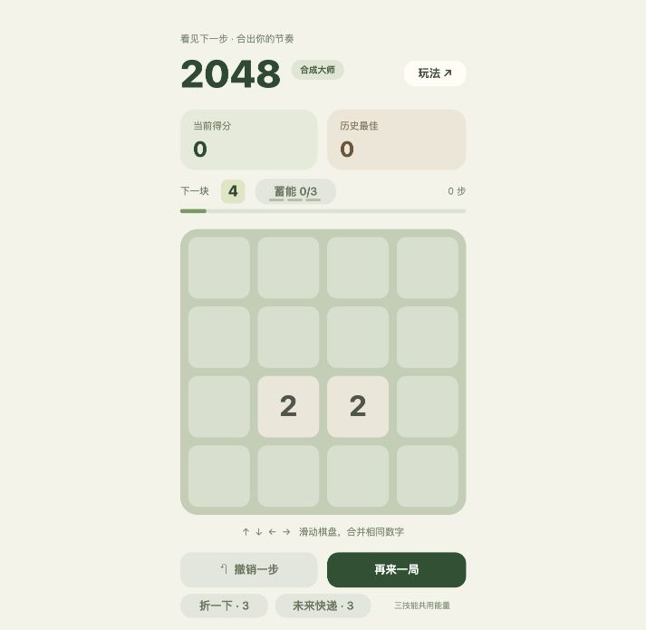
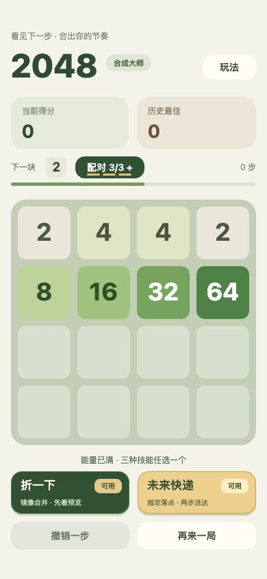
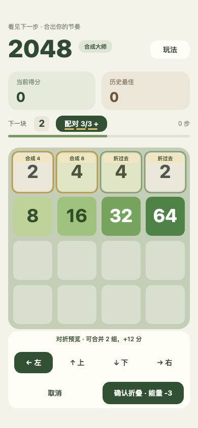
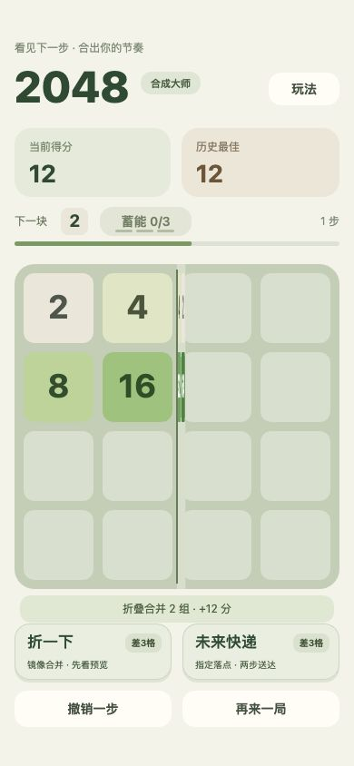
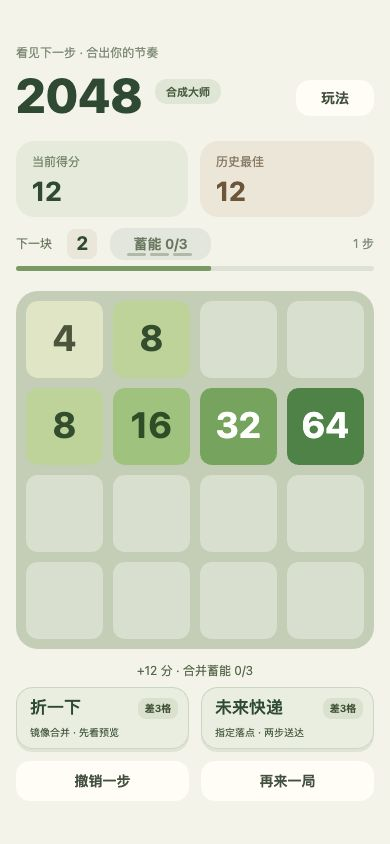
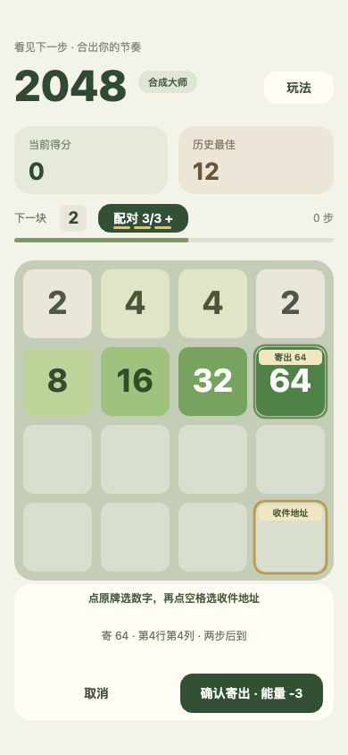
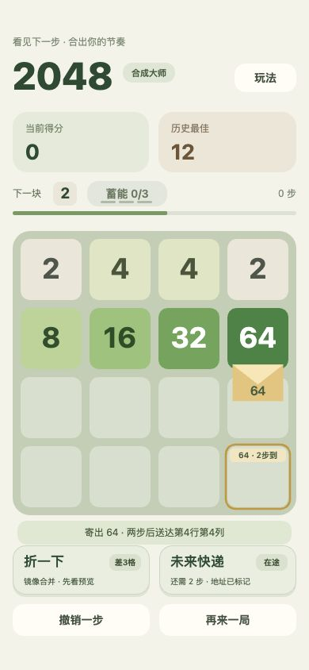

# 技能区与每日能量体验检查

日期：2026-10-17。范围：本项目单 Canvas 场景的技能发现、可用提醒、选择 / 确认、执行后状态；结合用户提供的底部截图。按 Product Design Audit 流程检查，并在同一轮直接修复。

## 已检查的操作与结果

| 步骤 | 画面与操作 | 结果 |
| --- | --- | --- |
| 1 | 原版普通主界面，713×695 浏览器视口 | 发现两个技能按钮仅 30 设计像素高；与礼包同排、视觉层级弱，难以解释数字 3 的意义；原布局未按原生底部 safeArea 留白 |
| 2 | 新版 390×844 浏览器视口，载入满能量对折示例 | 通过：两张 173×62 技能卡，深绿 / 暖金和「可用」双重提示，玩法副文案完整，下方撤销 / 重开层级降低 |
| 3 | 点击折一下，进入预览 | 通过：原牌和合成位置均标记，方向选择和确认区域加高，确认前不扣能量；截图显示两组合并 +12 |
| 4 | 确认对折、展开、撤销 | 通过：半盘旋转可见，最终首行 4、8，得分 12，能量 0；卡片显示差 3 格。撤销恢复棋盘和 3 格能量 |
| 5 | 点击未来快递，选择右下地址、确认寄出 | 通过：标记寄出 64 与收件地址；寄出后信封可见，技能卡显示「在途」，不重复引导用户消耗能量 |

## 截图

以下均为本轮实际浏览器捕获，检查后保存；截图 1 为修复前默认视口，其余为 390×844 手机尺寸视口。不是微信 / 抖音真机截图。

1. 修复前：
2. 满能量可用：
3. 对折预览：
4. 执行动效与结果： 
5. 快递选址与寄出： 

## 主要改进与取舍

- 特色技能靠近棋盘并拥有更大的点击区域；重开仍需确认，减少误触后丢失本局的风险。
- 每个按钮直接表达用途与状态；未满时显示缺少多少格，快递已寄出时显示在途，不能对折的棋盘显示可预览而不冒充可用。
- 新可用时只播放一次 1100ms 的双次轻弹、金边和扫光，之后保留静态颜色及文字。提醒不锁定输入，打开面板或开始新操作会结束提醒。
- 技能判定按状态缓存，每日奖励状态按事件读取，不在动画帧中反复读存储。按原预算限频，提醒结束无持续 RAF / 新增定时器。
- 抖音侧边栏能力保留，入口移至右上「每日能量」，主界面有入口但不与游戏技能争空间。微信和不支持的宿主隐藏。奖励仍为每日补满 3 格能量。

## 验证与边界

70 项测试通过。新增 8 项覆盖限时可用提醒、120Hz 回调下限频、无效可用状态、提醒不阻塞操作、减少动态效果、前后台、短屏 / 全面屏布局和原生坐标命中、每日奖励领取与防重领。

浏览器实际操作检查覆盖步骤 1～5。每日能量主界面入口、侧边栏跳转、返回领奖和日内限制由应用集成测试及平台适配测试验证；本轮未在微信 / 抖音宿主实机跑通这些新布局，需发布前验收。未执行手机功耗 / 温升测试。

无障碍方面，颜色之外增加文字状态，特效遵循浏览器减少动态效果；常见手机尺寸的特色技能点击高度经计算至少 44px，但极矮窗口仍会整体缩小。纯 Canvas 仍不能提供完整的逐按钮屏幕阅读器语义、Tab 焦点和系统字体缩放支持，截图不能证明完整无障碍合规。
