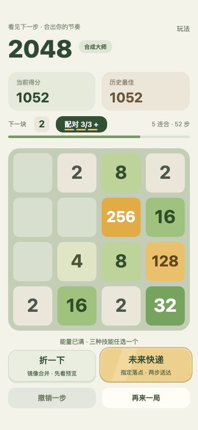
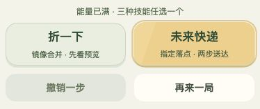

# 技能入口调整

2026-10-17，按最新反馈调整。

- 玩法：右上纯文字，无背景 / 边框 / 阴影，透明点击区域保留。
- 技能卡：移除状态徽标，标题 / 规则居中；实际可用状态决定底色，普通滑动不临时变灰。
- 提醒：可用时持续循环呼吸、金边和扫光；空闲仅 24fps 重绘技能区域。面板与后台暂停，返回恢复；减少动态效果时静态显示。

本轮截图保留了现有用户棋盘（1052 分、52 步），未载入示例覆盖进度。当前棋盘无同值镜像组合，因此折一下为浅色；未来快递满足使用条件，持续动画。浏览器中实际验证了玩法入口打开和关闭，关闭后循环提醒恢复。自动化共 72 项通过，包含两种技能的循环、限帧、局部绘制、后台隔离和绘制降级。宿主真机与功耗测试未执行。
