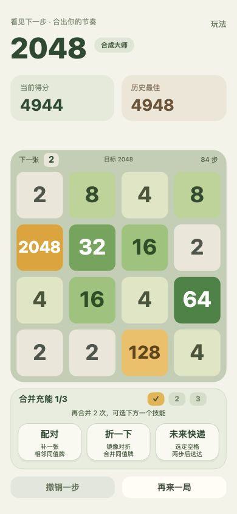
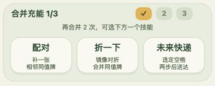
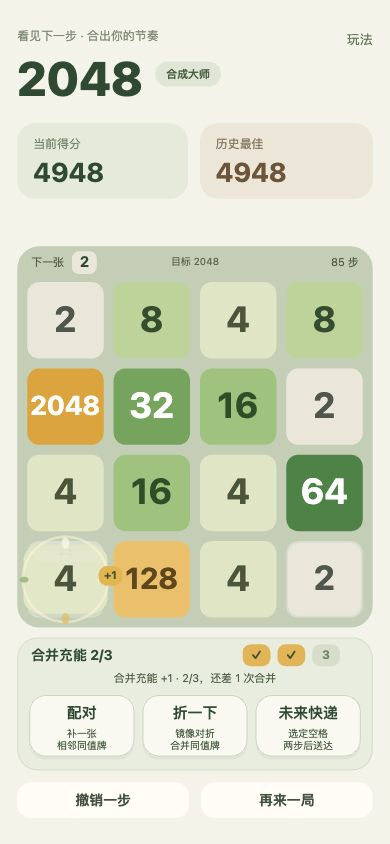

# 统一充能与技能面板

2026-10-17：把分散在棋盘上方的配对 / 小能量条，和下方两种技能归入同一面板。

- 三个明确的充能格 +「合并充能 N/3」。
- 直接说明还需几次合并，以及充满后可选择一个技能。
- 配对 / 折一下 / 未来快递并排，规则说明居中。
- 原长目标进度条移除；预告、目标和步数收进棋盘顶部。
- 一次合并滑动只充一格，用单个金色 +1 飞入对应充能格，短促回弹。

本轮在现有浏览器棋盘上测试了一次向左合并：分数 4944→4948、步数 84→85、充能 1/3→2/3，截图包含 +1 飞入。随后撤销恢复了原棋盘、分数、步数和充能，没有载入示例覆盖当前进度。75 项自动化测试通过，双平台由同一源码构建；真机与温升测试尚未执行。
