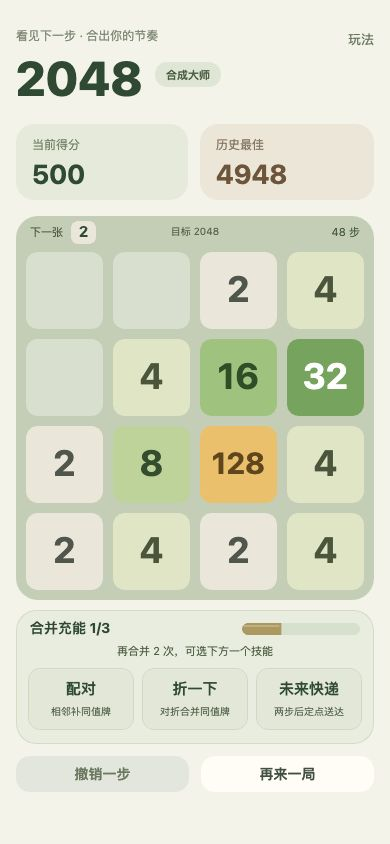
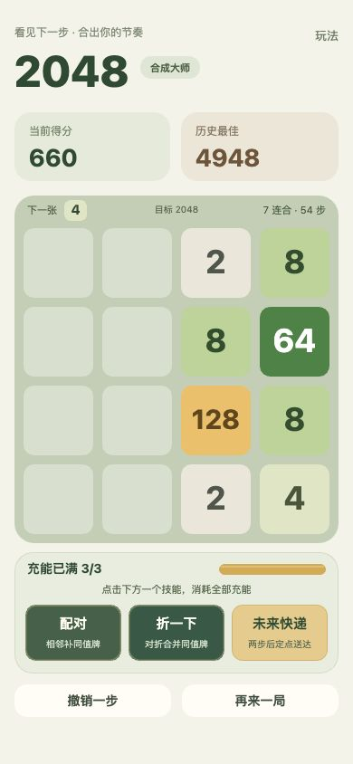

# 顶部留白、充能槽与按钮视觉调整

2026-10-17。

- 分数卡到棋盘间隔从 48 缩至 16 设计像素，游戏内容靠顶部对齐。
- 棋盘、技能区、选择面板及对应点击坐标一起上移 32 像素；存档和规则不变。
- 三个编号 / 勾选格改为连续充能槽，金色细高光；保留 N/3 和剩余合并次数，说明充满后的用途。
- 合并的 +1 飞向槽内进度末端，槽内缓动增长；回归检查确保填充不会先显示新进度又闪回旧进度。
- 按钮去掉厚底影，收敛圆角 / 边线，标题与单行说明居中。可用时绿色 / 暖金，不可用时浅色。
- 循环提醒不再缩放、抬起或移动扫光，只渐变边缘和表面亮度。局部绘制上限由 24 改为 30fps，循环 3200ms；循环边界亮度连续。

以上来自同一轮真实浏览器的不同游玩状态，没有载入示例替换进度。76 项测试通过。30fps 局部绘制与固定几何旨在减少可见顿挫和绘制开销，不等于所有手机都已经达到稳定帧率；宿主真机、长时间功耗 / 温升仍未测试。
